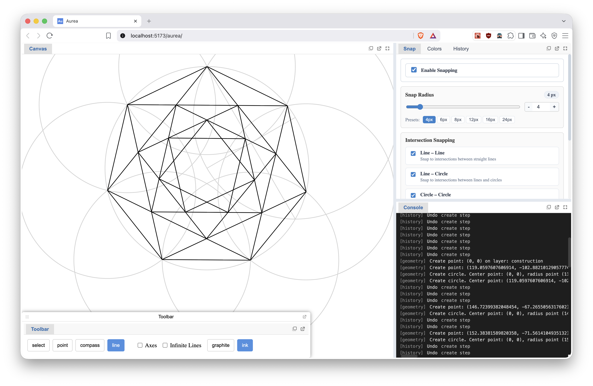

# Aurea

Sacred geometry construction software. Currently under development.

For SVG exports to Inkscape or other legacy SVG editors, select **SVG** in the
Export panel and enable **Legacy SVG color syntax**. This uses `rgb(...)` colors
with separate `stroke-opacity` and `fill-opacity` attributes to preserve transparency.
Leave the switch off to retain the default `rgba(...)` color syntax.

[video showcase](https://www.youtube.com/watch?v=tAEJfqxjrhQ) (outdated!)

